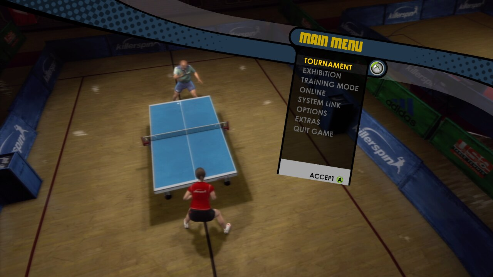
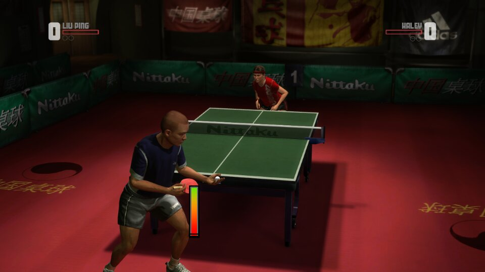
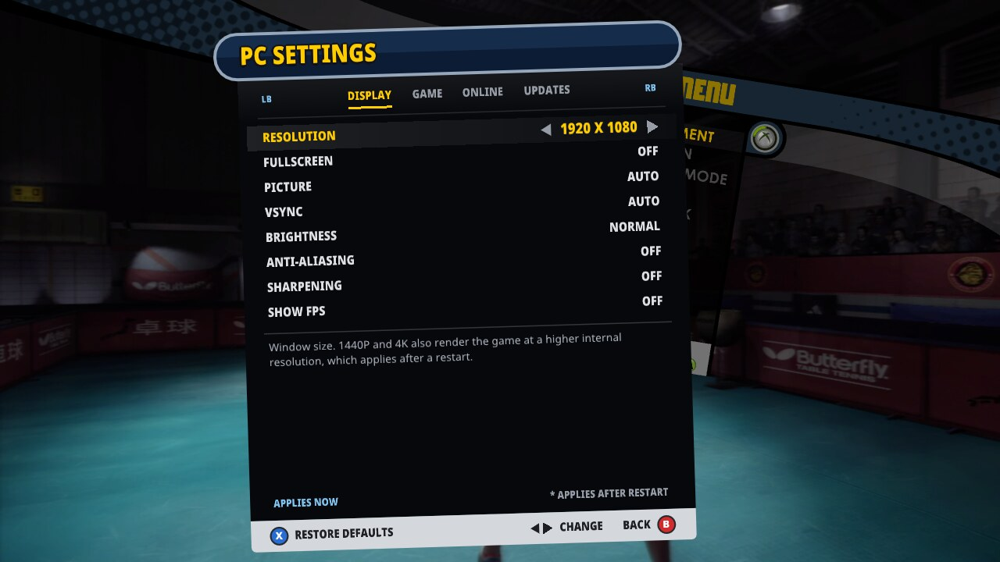
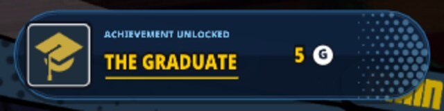
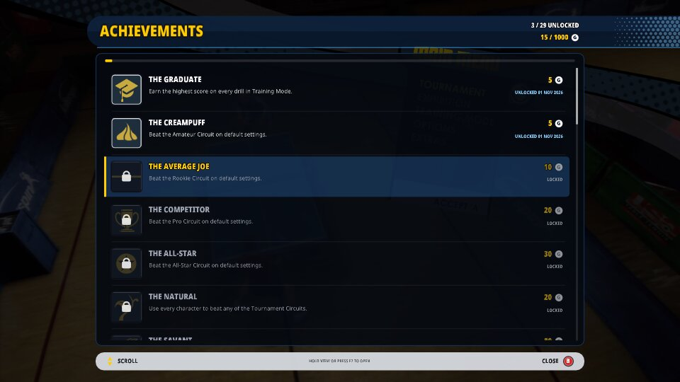
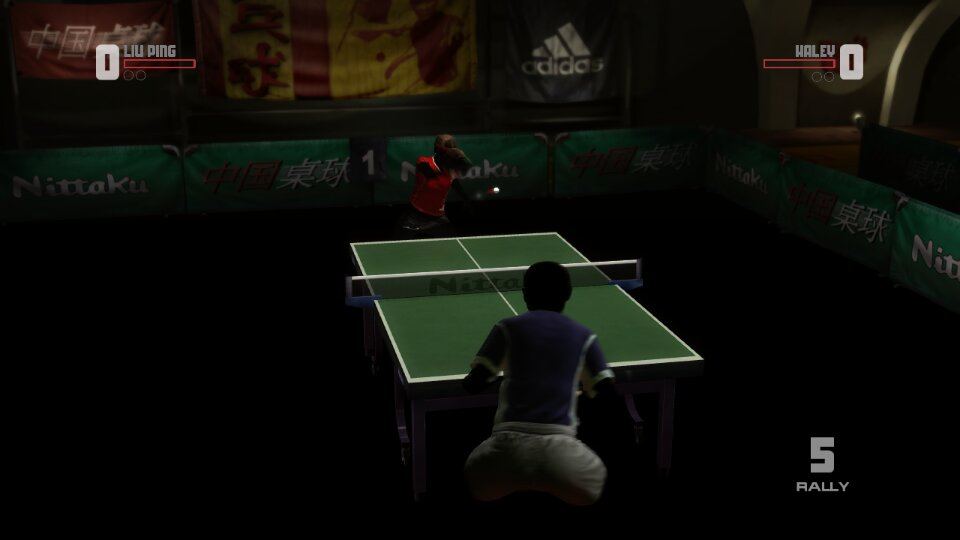

# Rockstar Games presents Table Tennis — Linux and Steam Deck

A native Linux port of the Xbox 360 classic, built on [davidptrssvea's Windows recompilation](https://github.com/davidptrssvea/Table-Tennis-Rockstar-PC). The game code is recompiled to native x86-64 with ReXGlue SDK v0.10.0 and rendered with Vulkan. It plays at a steady 60 FPS on desktop Linux and on the Steam Deck, with sound, saves, gamepad input and achievements, from **your own Xbox 360 disc image**.

<p align="center">
  
  
</p>

## Play on Linux

Requirements: x86_64 Linux, a Vulkan GPU, `python3`, `git`, `cmake`, `ninja` and `clang` 19 or newer, plus your own USA/Europe retail ISO (Title ID `545407DF`).

```sh
./build.sh --iso /path/to/TableTennis.iso
./dist/tt-recomp.sh
```

`build.sh` verifies and extracts the ISO read-only, builds ReXGlue SDK v0.10.0 from source into `.tools/rexglue-sdk` (pass `--sdk PATH` to use an existing one) with the fixes in `project/sdk-patches/`, runs code generation, applies the verified native edits and compiles the game into `dist/`. Nothing from the disc is ever committed or distributed; keep your build to yourself.

`dist/tt-recomp.sh` replaces the Windows launcher. It reads `dist/tt-recomp.ini` (same keys as the Windows `settings.ini`: `iso_path`, `resolution`, `framerate`, `fullscreen`, `show_fps`, `aa`, `post`, plus `aspect`, `gamemode` and `engine_flags`), and command-line flags override it, for example `./dist/tt-recomp.sh --resolution=1440p --fullscreen=true`. Add `--save` to write the options back; anything after `--` goes straight to the engine. Press Escape twice within two seconds to quit; F10 toggles the FPS counter.

### PC settings in the game's menu

The game's **OPTIONS** menu gets an extra entry, **PC SETTINGS**, added to your own menu file by the build's menu patch. It opens a page in the game's menu style for resolution, fullscreen, picture mode (letterbox or the experimental fill), anti-aliasing, the FPS counter, haptics and the achievement sound. Fullscreen, the FPS counter, haptics and the sound change immediately; the others are marked and apply the next time you start the game. Changes are saved to `tt-recomp.ini`, the same file the launcher reads. Use the D-pad to choose and change, and B to go back.

<p align="center">
  
</p>

### Controller haptics

The original game only rumbles on some shots. This port adds a pulse on every ball hit and a tick when moving through the menus, with a stronger one on A and B; menu ticks are off during play. They work on the Steam Deck's built-in controller and other SDL gamepads with rumble, and can be switched off with **HAPTICS** in PC SETTINGS (`haptics=false` in `tt-recomp.ini`).

### Achievements

All 29 achievements (1000 gamerscore) load from your copy of the game, and the game's unlock calls are recorded. Progress is saved in `user_data/achievements/`. The online-only achievements can no longer be earned.

- **Unlock popup:** slides up into the bottom right corner of the picture, with a highlight sweep, the icon popping in, the gamerscore counting up and an eased exit. Several unlocks play one after another.
- **Sound:** a short ping-pong sound plays with it: a whoosh, two ball bounces and a marimba roll, synthesized by the game build itself. Turn it off with `engine_flags=--achievement_sound=false`.
- **Achievements list:** press F7, or hold the View/Back button for a moment on a controller. Scroll with the D-pad or stick and close with B. A short Back press still reaches the game.
- **Style:** both are drawn in the game's own menu style and scale with the picture at any resolution, using the Noto Sans font (SIL Open Font License, see `licenses/NotoSans/`).

<p align="center">
  <br>
  
</p>

Keep `framerate=60`. The game advances its simulation once per frame and was built for 60 frames per second: higher settings only repeat frames, and uncapped presentation competes with the emulated GPU and slows gameplay down.

## Steam Deck

A build made on a rolling distribution needs its newer system libraries, so `scripts/deck/build-deck.sh` (after a normal `./build.sh`) rebuilds the SDK and the game in an Ubuntu 24.04 container with clang 20 (`scripts/deck/make-image.sh` creates it, rootless podman), bundles the C++ runtime and writes a private package to `logs/build/tt-recomp-deck.tar.xz` (about 10 MB). It needs glibc 2.38 or newer and an x86-64-v3 (AVX2) CPU, and contains nothing from the disc.

On the Deck, unpack it and run `./setup-deck.sh /path/to/TableTennis.iso` once: it extracts and patches the menu archive from your own ISO and selects 1280x800 fullscreen. Then add `tt-recomp.sh` to Steam as a non-Steam game and start it from Steam (in Game Mode or Desktop Mode); outside Steam the Deck's desktop layout turns B into Escape and the right stick into a mouse. The launcher starts the game through GameMode when it is available.

The Deck shows the original 16:9 picture with thin bars (`aspect=letterbox`). `aspect=fill` is experimental: it renders the match view for the 16:10 screen and fills it, but menus, the HUD and some scenes (such as character select) come out stretched. The first time a scene appears its shaders compile and it can hitch briefly; after that it comes from the shader cache.

## What the Linux port fixes

<p align="center">
  
  
</p>

The SDK's Vulkan backend had not been used for this game before. The fixes are kept as small patches in `project/sdk-patches/` and applied to the pinned SDK source by `build.sh`:

1. **Lighting (above).** The Vulkan shader translator read each texture's exponent adjustment from the wrong word of the texture descriptor, so textures with a LOD bias came out up to 2^32 times too dark: a black arena floor, dark skin, a dark character select screen. (Upstream PR rexglue/rexglue-sdk#490.)
2. **Full-speed gameplay.** Every game write to memory the GPU watches looked up page permissions by parsing `/proc/self/maps` as text. On the Steam Deck that held matches to 24-27 game frames per second, which played in slow motion. The lookup now uses the kernel's `PROCMAP_QUERY` call (Linux 6.11+), with the old method as a fallback.
3. **Correct picture shape.** The SDK reported the window size to the game as its TV mode, which stretched the picture on the Deck's 16:10 screen and switched small windows to the game's 4:3 SD layout.
4. **CPU usage.** The audio thread spun a whole CPU core waiting for work (now about 5%), and a debug-only lookup ran on every GPU register write.
5. **RenderDoc.** An installed RenderDoc was injected into every run. (Upstream PR rexglue/rexglue-sdk#522.)

All PC options from the Windows version work except FSR and CAS sharpening: AMD's FidelityFX build runs a Windows shader compiler under Wine that fails with current glslang, so Linux uses bilinear scaling. The [devlog](docs/DEVLOG.md) tells the story of the port, and `scripts/` holds the unattended test runner (`autotest.sh`), the Steam Deck packaging and the RenderDoc analysis scripts used to find these bugs.

## Windows PC version (upstream)

The rest of this README describes the original Windows recompilation this port is based on.


Bring the Xbox 360 classic to your PC with **up to 4K output, higher internal 3D resolution, high-refresh framerate options, and optional image filters**. The game code is recompiled to native Windows x64 with ReXGlue SDK v0.10.0 and DirectX 12 rendering.

Build and play from **your own Xbox 360 disc image**. A graphical installer prepares the required components and creates the local game build for you.

### Get started

1. Download **[Install-Table-Tennis.exe — installer preview](https://github.com/davidptrssvea/Table-Tennis-Rockstar-PC/releases/download/v1.0.5/Install-Table-Tennis.exe)**.
2. Open it, choose your retail **Table Tennis ISO**, allow the required components, and click **Install**.
3. When it says **Ready to play**, click **Play**. A desktop shortcut is also created when Windows permits it.

On the first launch, **Saved Game** may ask whether to create a save. Choose **A** to create one or **B** to continue without saving, then follow any further on-screen confirmation. This question is now visible and interactive during intro skipping.

**You do not need to install Python, compilers or SDKs manually. You do not need a command prompt or the source ZIP.**

First setup needs internet access, several GB of free space and time to download components and build the game. If Microsoft build components are missing, Windows may ask for administrator permission. Nothing restarts Windows automatically; if a restart is required, the installer tells you to reopen it afterward.

### What you need

- Windows 10/11 **x64**, an AVX2 CPU and a DirectX 12 GPU.
- Your own unmodified **USA/Europe retail Xbox 360 Table Tennis ISO**, Title ID `545407DF`.
- A writable installation folder. The default is `%LOCALAPPDATA%\TableTennisPC`.

The ISO is checked before installing large compiler components and is always opened read-only. Other game versions are rejected. Keep your ISO available after installation: the game still reads it during play.

### PC enhancements

#### Sharper 3D rendering — up to 4K

Choose your display preset directly in the game launcher:

| Preset | Output resolution | Internal 3D rendering scale |
|---|---|---|
| **720p** | 1280 × 720 | 1× |
| **1080p / Full HD** | 1920 × 1080 | 1×, presented with your chosen image filter |
| **1440p / QHD** | 2560 × 1440 | 2× on each axis |
| **4K / Ultra HD** | 3840 × 2160 | 3× on each axis |

The 1440p and 4K presets raise the internal rendering scale as well as the output size. The 1080p preset keeps 1× internal rendering and uses the selected presentation filter for output scaling.

#### High-refresh display options

Select **60, 120, 144 or 240 FPS targets**, or choose **Unlocked** for uncapped presentation. A 60 FPS VSync option is available, while higher-framerate modes enable the variable-refresh/tearing presentation path for compatible displays, including suitably configured G-Sync and FreeSync setups.

Pick the resolution and framerate combination that suits your GPU and monitor. Achieved FPS depends on your hardware, scene and settings; these are selectable targets rather than guaranteed benchmark results.

#### Image filters and anti-aliasing

- **FXAA** and **FXAA Extreme** options for edge smoothing, plus an Off setting.
- **AMD FidelityFX FSR**, **Contrast Adaptive Sharpening (CAS)** or **Bilinear** presentation options.
- **Fullscreen or windowed mode**, configured before launching the game.

#### A more convenient PC experience

- **Graphical settings launcher:** choose your ISO, resolution, framerate, display mode and image filters in one place; settings are saved for the next launch.
- **Live FPS and frame-time overlay:** toggle it with **F10** while playing.
- **Quick exit:** press **Escape** to return to Windows.
- **SDL3 gamepad support**, with controller detection active before the startup intro.

#### Offline menu and startup improvements

- Xbox Live removed from the main menu to avoid the unavailable online screen. Tournament, Exhibition, Training Mode, Options and Extras remain available.
- A gamepad button immediately stops the startup intro and continues to the main menu after loading, without another Start press.
- A large, centered, antialiased **LOADING MAIN MENU...** transition while the menu initializes. The skip press cannot accidentally select a menu item.

### If installation stops

**Music plays but `LOADING MAIN MENU...` never disappears?** In v1.0.3 and earlier, the loading overlay could hide the first-run save question and block the controls needed to answer it. Download the **v1.0.5 installer**, choose the same ISO and installation folder, and rebuild. Your existing saves are retained. Afterward, answer the visible **Saved Game** question if it appears.

**Already installed, but starting the game says `--game_data_root does not exist` even though your ISO exists?** Versions 1.0.1/1.0.2 could build with the SDK's directory-only startup code. Download the **v1.0.5 installer** above, choose your ISO and the **same installation folder**, then run Install / Recheck to rebuild with ISO support. You do not need to delete your installation. Start through **tabletennis_launcher.exe** afterward; the ISO must remain available.

Click **Open log** in the installer. You can retry after fixing the reported issue; downloaded components are cached. If Windows security blocks a required component, installation stops and security settings remain unchanged.

The installer is not code-signed. Automatic installation of missing Microsoft components has not yet been tested on a completely clean Windows machine. The installer backend was tested with its downloaded portable Python runtime and existing compiler/SDK installations. The separate ReXGlue download was previously blocked by security software on the development PC; that first-download path remains unverified.

Existing local saves and graphics settings are retained during repair; the selected ISO path is updated. First-run save creation and startup with that save were checked in isolated profiles; gameplay progress save/load was not fully revalidated.

### How it works

The small installer contains project source and patch instructions. It downloads a checksum-verified, isolated Python runtime and checks for suitable build tools. If needed, it starts Microsoft's signed Visual Studio 2022 Build Tools installer with the required C++/Windows SDK/CMake/Ninja/Clang components selected. The screen asks permission for component downloads and installation before starting.

It then obtains ReXGlue SDK v0.10.0, checks its pinned SHA-256, reads the supported executable and menu archive from your ISO, generates and patches the game code, and builds everything **on your PC**. No retail menu archive, XEX, ISO, generated game functions or prebuilt game executable is included in the public downloads. `Install-Table-Tennis.exe` is our own installer, not the game executable.

Locally generated files stay under the installation folder. Do not upload `dist`, `private_work` or `project/generated`.

<details>
<summary>Developer / advanced installation</summary>

The **Table-Tennis-Local-Build-v1.0.5.zip** asset is the source package for developers. It is not required by players using the installer.

For manual builds, install 64-bit Python 3.10+, Visual Studio 2022 C++ Build Tools with Windows SDK/CMake/Ninja, and Clang 19+. Clang can be standalone or included in Visual Studio. Then use:

```powershell
.\setup.ps1 -IsoPath 'E:\Games\TableTennis.iso' -SdkPath 'E:\Tools\rexglue-sdk-0.10.0' -NoDownload
```

`SdkPath` must contain `bin\rexglue.exe` and `lib\cmake\rexglue`. Add `-Jobs 2` for lower memory use or `-PrepareOnly` to stop after code generation and patches. The installer can also use a supplied SDK via its optional `--sdk PATH` argument.

Checks and source packaging:

```powershell
py -3 -m unittest discover -s tests -v
py -3 project/tools/package_source.py --audit-index
py -3 project/tools/package_source.py --output 'E:\ReleaseOutput'
powershell -File project/tools/build_installer.ps1 -SourceZip 'E:\ReleaseOutput\Table-Tennis-Local-Build-v1.0.5.zip' -OutputPath 'E:\ReleaseOutput\Install-Table-Tennis.exe'
```

The installer builder validates every embedded source file against the public allowlist before compilation. It rejects extra or altered payload files. Native patch rules store offsets, hashes and replacement text rather than removed original function bodies. See [implementation and validation](reports/LOCAL_BUILD.md) and [changelog](CHANGELOG.md).

</details>

## License and rights

### Desktop icon credit

Desktop icon artwork by **Gary aka POOTERMAN :)** — [visit POOTERMAN on DeviantArt](https://www.deviantart.com/pooterman). Thank you for the artwork! The supplied image was converted into a Windows icon in multiple sizes for the launcher and desktop shortcut. The artwork is credited separately and is not covered by this project's MIT license.

Project-authored integration, installer and tools use the [MIT license](LICENSE). Adapted ReXGlue SDK headers, the ISO application adapter and SDK-derived CMake integration retain their BSD 3-Clause notices; see [ReXGlue license](licenses/ReXGlue/LICENSE.txt). [SDL's notice](licenses/SDL3/LICENSE.txt) is retained. Downloaded components have their own licenses: [Microsoft](https://visualstudio.microsoft.com/license-terms/) and [Python](https://docs.python.org/3/license.html).

Rockstar Games and Take-Two retain rights to their original game and material, including the game imagery shown in the screenshots above, which are included only to document this port. This project is independent and unaffiliated. No project license grants rights to the original game. Local generation reduces what this project distributes; it is **not a guarantee of legal compliance**. You must have the necessary rights to use and process your copy.
