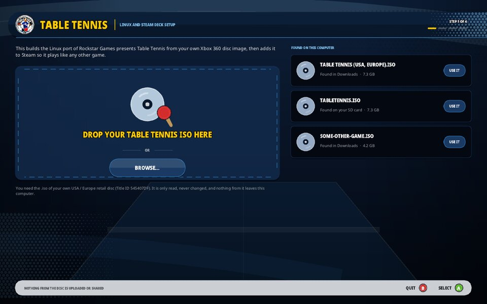
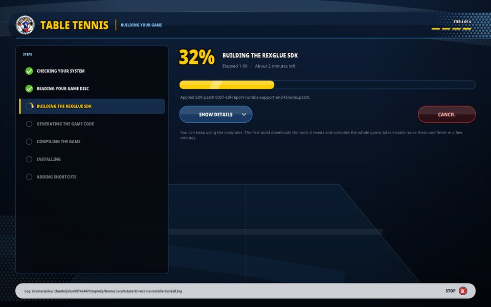

# Rockstar Games presents Table Tennis — Linux and Steam Deck

A native Linux port of the Xbox 360 classic, built on [davidptrssvea's Windows recompilation](https://github.com/davidptrssvea/Table-Tennis-Rockstar-PC). The game's code is recompiled to native x86-64 with ReXGlue SDK v0.10.0 and rendered with Vulkan. It plays at a steady 60 FPS on Linux PCs and on the Steam Deck, with sound, saves, controller haptics, achievements and in-game PC settings, from **your own Xbox 360 disc image**.

<p align="center">
  
  
</p>

## Install

1. Download **[install-table-tennis-linux-x86_64.tar.gz](https://github.com/ThisIsAkill/Table-Tennis-Linux/releases/latest/download/install-table-tennis-linux-x86_64.tar.gz)** from the [latest release](https://github.com/ThisIsAkill/Table-Tennis-Linux/releases/latest) and unpack it (on a Steam Deck, do this in Desktop Mode).
2. Open the `TableTennis-Installer` folder and double-click **install-table-tennis** (or run `./install-table-tennis` in a terminal).
3. Drop your Table Tennis ISO on the window, press **BROWSE...**, or pick one of the ISOs it found in your Downloads, Desktop, Games folder or on an SD card. It checks that it is the right disc.
4. Choose where to install (internal storage is recommended; SD cards and any other folder work too), whether to **add the game to Steam as a non-Steam game** (so it shows up in your library and in Game Mode on the Steam Deck) and whether to add a desktop shortcut, then press **INSTALL**.
5. When it says **Ready to play**, press **PLAY**. On a Steam Deck you can go back to Game Mode and start it from Library > Non-Steam.

The mouse, touch screen, keyboard and controller all work in the installer.

<p align="center">
  
  
</p>

### What you need

- A 64-bit x86 PC with an AVX2 CPU (most PCs since 2015, and the Steam Deck) and a Vulkan GPU.
- Your own unmodified **USA/Europe retail Xbox 360 Table Tennis ISO** (Title ID `545407DF`). It is only read, never changed, and nothing from it leaves your computer. Keep it where it is after installing: the game reads it while you play.
- An internet connection for the first install, and about 1 GB free in the install folder plus about 3 GB temporary space for build files.

### What the installer does

The game cannot be downloaded ready-made, because it is built from the code on your own disc. The installer does that for you on your machine, the same way the Windows version's installer does: it downloads the build tools and the prebuilt engine from the release once (about 125 MB), turns your disc's Xbox code into native code and compiles it, then installs the game with its settings, desktop entry and Steam shortcut. A first install takes about a minute on a desktop PC (45 seconds measured on a Ryzen 5 5600X) and should take a few minutes on a Steam Deck; later installs and updates reuse everything and finish in seconds.

If the prebuilt files cannot be downloaded, it builds the engine too and fetches whatever tools are missing: it uses podman or docker when available, otherwise your system's compilers, otherwise an official Ubuntu base system unpacked into your cache folder, without needing admin rights. That takes a few more minutes the first time.

| What | Where |
|---|---|
| The game | the install folder (default `~/Games/TableTennis`) |
| Settings | `tt-recomp.ini` in the install folder |
| Saves, achievements, shader cache | `~/.local/share/tabletennis` (kept when you reinstall or move the game) |
| Build tools and caches | `~/.cache/tt-recomp` (can be deleted after installing; updates are then slower once) |

To uninstall, delete the install folder (and the cache folder), remove the shortcut from Steam, and delete `~/.local/share/tabletennis` if you also want to remove your saves.

The same install runs without a window with `scripts/install/tt-install.sh --iso /path/to/TableTennis.iso` from the unpacked folder; see [scripts/install/README.md](scripts/install/README.md) for its options.

## Updates

The game checks for a new release in the background when it starts, at most every six hours. When there is one, the main menu shows an **UPDATE AVAILABLE** popup. Go to **OPTIONS > PC SETTINGS** and choose the version row (**UPDATE TO ...**) to see what is new and update: the game closes, updates in about a minute and starts again. Your saves and settings are kept, and if an update fails the current version keeps working.

In PC SETTINGS, **CHECK NOW** looks for a new version right away and offers it if there is one, **CHECK AT START** turns the check at start off and **AUTOMATIC UPDATES** installs new versions by itself when the game starts. Releases are signed, and the game only installs updates signed with this project's key. The check only downloads the public release information from GitHub; nothing about you or your game is sent.

## Features

### PC settings in the game's menu

The game's **OPTIONS** menu, both in the main menu and in the pause menu during a match, has a **PC SETTINGS** entry below AUDIO OPTIONS. It opens a page in the game's own style:

| Setting | Values | Applies |
|---|---|---|
| Resolution | 1280x720, 1280x800 (Steam Deck), 1920x1080, 2560x1440, 3840x2160 | at once (1440p and 4K, which also raise the internal render resolution: after a restart) |
| Fullscreen | on / off | at once |
| Picture | letterbox (the original 16:9) / fill screen (experimental) | after a restart |
| Anti-aliasing | off / FXAA / FXAA extreme | at once |
| Sharpening | off / CAS (sharpens; best on the Steam Deck) / FSR (upscales to large screens and sharpens) | at once |
| VSync | auto (on for macOS, off elsewhere) / on / off: waits for the display, so the picture does not tear | at once |
| Show FPS | on / off | at once |
| Haptics | on / off | at once |
| Achievement sound | on / off | at once |
| Player name | the name others see online and in System Link (press A, then the D-pad or a keyboard) | after a restart |
| Check at start, automatic updates | on / off | next start |
| Check now | looks for a new version right away | at once |

Use the D-pad to choose and change, **X** to restore the defaults (1280x800 fullscreen on a Steam Deck) and **B** to go back. Changes are saved to `tt-recomp.ini`.

<p align="center">
  
</p>

### Controller haptics

The original game only rumbles on some shots. This port adds a firm pulse on every ball hit, a light tick when moving through the menus and a stronger one on A and B (menu ticks are off during play). They work on the Steam Deck's built-in controller and other controllers with rumble.

### Achievements

All 29 achievements (1000 gamerscore) come from your copy of the game and unlock as you play; the online-only ones can no longer be earned.

- **Unlock popup:** slides into the bottom right corner of the picture with the achievement's icon, name and gamerscore, and a short ping-pong sound: a whoosh, two ball bounces and a marimba roll, made by the game build itself.
- **Achievements list:** open it from **EXTRAS > ACHIEVEMENTS** in the game's menu, by holding the **View/Back** button for a moment on a controller, or with F7. Scroll with the D-pad or stick and close with B. A short Back press still reaches the game.
- **Style:** both are drawn in the game's own menu style with the Noto Sans font (SIL Open Font License, see `licenses/NotoSans/`).

<p align="center">
  <br>
  
</p>

### Online and System Link play

Two players can play a match against each other, on the same network or over the internet. The main menu has two entries that both open the game's own online menus (PLAYER MATCH, QUICK MATCH, CREATE MATCH, lobby):

- **ONLINE** plays over the internet through an online server. It first asks how: **PLAY ANYONE** joins the public room, **PLAY WITH A FRIEND** either shows a six-character code to give your friend (**SHOW MY CODE**) or lets you type theirs with the D-pad (**ENTER CODE**). Only players in the same room see each other's matches. No ports or IP addresses to set up: the game connects to the server, and the match itself runs directly between the two machines when the networks allow it, or through the server when they do not.
- **SYSTEM LINK** plays on the local network, for example a Steam Deck and a PC on the same Wi-Fi.

Then, on one machine choose **PLAYER MATCH > CREATE MATCH**, accept the settings and wait in the lobby; on the other choose **PLAYER MATCH > QUICK MATCH**, which finds the match and joins the lobby. The host presses Start (or A on START) to begin.

Notes:

- Online play works out of the box: the game connects to the project's online server by itself, with nothing to set up. PC SETTINGS shows the server and the connection status under ONLINE. To use a different server (for example your own, see [server/README.md](server/README.md)), set `server=` in `tt-recomp.ini`.
- The game was made for local networks: every action waits for the other machine, so online matches play well between players in the same region and feel delayed across continents. While online, a small box in the bottom right corner (outside matches) shows the connection to the other player: bars, the round trip in milliseconds, packet loss and whether it runs directly or through the server, with a warning above 150 ms or 2% loss, and REDUNDANT while the game sends every match packet twice to cover packet loss (`online_redundancy=` in `tt-recomp.ini`: `auto`, the default, does this only while packets get lost; `on` or `off`). In the public room the server first pairs players who are close to each other and only looks further away when you keep searching (see [server/README.md](server/README.md#nearby-matchmaking)); the ONLINE prompt shows how many players are near you.
- Each player is named automatically after the computer, with a short code so that two Steam Decks get different names (for example `steamdeck-4f2`). To choose your own, open **PC SETTINGS > PLAYER NAME** (up to 15 letters, digits, `-` and `_`; it is saved as `player_name=` in `tt-recomp.ini` and used from the next start). The game tells players apart by name, so the online server does not let two players with the same name into one room.
- System Link uses UDP ports 11000, 11001 and 13075 on the local network. A PC firewall must allow them, for example `sudo ufw allow 11000:11001/udp` and `sudo ufw allow 13075/udp`. SteamOS has no firewall by default. Online play needs no open ports.
- If machines on the same network do not find each other (some access points and VPNs drop broadcasts), add `lan_peers=` with the other machine's IP address to `tt-recomp.ini` on both.
- PLAYER MATCH works; RANKED MATCH, TABLE TENNIS NETWORK and LEADERBOARDS were Xbox LIVE services. `system_link=false` turns both entries off and brings back the offline behaviour of earlier versions.

### Steam Deck

- Add the game to Steam during installation and play it in Game Mode with the Deck's controls; outside Steam, the Deck's desktop layout turns B into Escape and the right stick into a mouse.
- It runs at 60 FPS. Sleep and resume in the middle of a match work.
- The picture is the original 16:9 with thin bars. **Fill screen** in PC SETTINGS renders the match view for the 16:10 screen but stretches menus, the HUD and some scenes, so it is experimental.
- The first time a scene appears its shaders are compiled and it can hitch briefly; after that they come from the shader cache.
- The launcher starts the game through Feral GameMode when it is installed.

### Tips

- Keep the frame rate at 60. The game advances its simulation once per frame and was built for 60 frames per second: higher settings only repeat frames, and uncapped presentation slows gameplay down.
- Press Escape twice within two seconds to quit with a keyboard. F10 toggles the FPS counter.
- On a PC with a strong GPU, `render_scale=2` (or `3`) in `tt-recomp.ini` renders the 3D view above the screen's resolution and scales it down for a sharper picture. The Steam Deck cannot hold 60 FPS with it.

## What the Linux port fixes

<p align="center">
  
  
</p>

The SDK's Vulkan backend had not been used for this game before. The fixes are small patches in `project/sdk-patches/`, applied to the pinned SDK source:

1. **Lighting (above).** The Vulkan shader translator read each texture's exponent adjustment from the wrong word of the texture descriptor, so textures with a LOD bias came out up to 2^32 times too dark: a black arena floor, dark skin, a dark character select screen. (Upstream PR rexglue/rexglue-sdk#490.)
2. **Full-speed gameplay.** Every game write to memory the GPU watches looked up page permissions by parsing `/proc/self/maps` as text. On the Steam Deck that held matches to 24-27 game frames per second, which played in slow motion. The lookup now uses the kernel's `PROCMAP_QUERY` call (Linux 6.11+), with the old method as a fallback.
3. **Correct picture shape.** The SDK reported the window size to the game as its TV mode, which stretched the picture on the Deck's 16:10 screen and switched small windows to the game's 4:3 SD layout.
4. **CPU usage.** The audio thread spun a whole CPU core waiting for work (now about 5%), and a debug-only lookup ran on every GPU register write.
5. **Controller rumble.** Gamepads now report whether they can rumble, and a failing rumble request is logged instead of being dropped silently.
6. **RenderDoc.** An installed RenderDoc was injected into every run. (Upstream PR rexglue/rexglue-sdk#522.)

7. **FSR and CAS.** AMD's FSR 1 upscaling and CAS sharpening use shaders that ship prebuilt with the SDK and only need AMD's headers, but the SDK only enabled them together with the FidelityFX runtime for temporal FSR 2/3, whose shader build runs a Windows compiler under Wine and fails on Linux. The runtime is now left out on Linux, so FSR and CAS work; temporal FSR 2/3 is not available.

All PC options from the Windows version work. The [devlog](docs/DEVLOG.md) tells the story of the port.

## For developers

Building from a checkout needs x86_64 Linux, `python3`, `git`, `cmake`, `ninja` and `clang` 19 or newer:

```sh
./build.sh --iso /path/to/TableTennis.iso
./dist/tt-recomp.sh
```

`build.sh` verifies and extracts the ISO read-only, builds ReXGlue SDK v0.10.0 from source into `.tools/rexglue-sdk` (`--sdk PATH` uses an existing one) with the patches in `project/sdk-patches/`, runs code generation, applies the verified native edits and compiles the game into `dist/`. A development build has no version file, shows DEV BUILD in PC SETTINGS and never offers updates.

`dist/tt-recomp.sh` is the launcher. It reads `tt-recomp.ini` next to it (keys: `iso_path`, `resolution`, `framerate`, `fullscreen`, `show_fps`, `aa`, `post`, `aspect`, `achievement_sound`, `haptics`, `render_scale`, `check_updates`, `auto_update`, `gamemode`, `player_name`, `lan_peers`, `server`, `online_redundancy`, `keyboard`, `vsync`, `engine_flags`). `keyboard=on` adds keyboard controls for testing without a controller: W A S D or the arrow keys move, I J K L are the four spins in the controller's diamond, Q soft shot, E focus shot, F full focus, C camera, Space/Enter accept, Backspace back, P pause; command-line flags override it, for example `./dist/tt-recomp.sh --resolution=1440p --fullscreen=true`, `--save` writes them back, and anything after `--` goes straight to the engine.

| Path | What it is |
|---|---|
| `project/src/` | game-side code: PC SETTINGS, achievement UI, haptics, update popup, intro skip |
| `project/sdk-patches/` | the SDK fixes listed above |
| `project/tools/` | ISO reader, menu patch (PC SETTINGS entries), native edits |
| `tools/installer/` | the graphical installer (SDL3 + Dear ImGui); `tools/installer/build.sh` builds it |
| `scripts/install/` | the install and update engine used by the installer ([README](scripts/install/README.md)) |
| `scripts/release/` | building and signing releases ([README](scripts/release/README.md)) |
| `scripts/autotest.sh`, `scripts/scenarios/` | unattended test runs under Xvfb |
| `scripts/rdc/` | RenderDoc analysis scripts used to find the rendering bugs |
| `scripts/deck/` | a private all-in-one Steam Deck package built in a container (for your own use only, since it contains the compiled game) |

## What is in a release

Releases contain only open-source, game-free files: the installer and the source code of this project, the prebuilt ReXGlue SDK (an open-source Xbox 360 runtime, with the patches above), slim build tools (Ubuntu 24.04 packages and LLVM's clang, with the source packages of the GPL parts attached to the release), a manifest with every file's SHA256, and its Ed25519 signature. No game files, no game code and nothing from the disc are distributed; the game is always built on the player's machine from their own disc. The source code refers to the game only by function addresses and checksums, and the README screenshots show Rockstar's game to document this port.

## Windows PC version (upstream)

The rest of this README describes the original Windows recompilation this port is based on.


Bring the Xbox 360 classic to your PC with **up to 4K output, higher internal 3D resolution, high-refresh framerate options, and optional image filters**. The game code is recompiled to native Windows x64 with ReXGlue SDK v0.10.0 and DirectX 12 rendering.

Build and play from **your own Xbox 360 disc image**. A graphical installer prepares the required components and creates the local game build for you.

### Get started

1. Download **[Install-Table-Tennis.exe — installer preview](https://github.com/davidptrssvea/Table-Tennis-Rockstar-PC/releases/download/v1.0.5/Install-Table-Tennis.exe)**.
2. Open it, choose your retail **Table Tennis ISO**, allow the required components, and click **Install**.
3. When it says **Ready to play**, click **Play**. A desktop shortcut is also created when Windows permits it.

On the first launch, **Saved Game** may ask whether to create a save. Choose **A** to create one or **B** to continue without saving, then follow any further on-screen confirmation. This question is now visible and interactive during intro skipping.

**You do not need to install Python, compilers or SDKs manually. You do not need a command prompt or the source ZIP.**

First setup needs internet access, several GB of free space and time to download components and build the game. If Microsoft build components are missing, Windows may ask for administrator permission. Nothing restarts Windows automatically; if a restart is required, the installer tells you to reopen it afterward.

### What you need

- Windows 10/11 **x64**, an AVX2 CPU and a DirectX 12 GPU.
- Your own unmodified **USA/Europe retail Xbox 360 Table Tennis ISO**, Title ID `545407DF`.
- A writable installation folder. The default is `%LOCALAPPDATA%\TableTennisPC`.

The ISO is checked before installing large compiler components and is always opened read-only. Other game versions are rejected. Keep your ISO available after installation: the game still reads it during play.

### PC enhancements

#### Sharper 3D rendering — up to 4K

Choose your display preset directly in the game launcher:

| Preset | Output resolution | Internal 3D rendering scale |
|---|---|---|
| **720p** | 1280 × 720 | 1× |
| **1080p / Full HD** | 1920 × 1080 | 1×, presented with your chosen image filter |
| **1440p / QHD** | 2560 × 1440 | 2× on each axis |
| **4K / Ultra HD** | 3840 × 2160 | 3× on each axis |

The 1440p and 4K presets raise the internal rendering scale as well as the output size. The 1080p preset keeps 1× internal rendering and uses the selected presentation filter for output scaling.

#### High-refresh display options

Select **60, 120, 144 or 240 FPS targets**, or choose **Unlocked** for uncapped presentation. A 60 FPS VSync option is available, while higher-framerate modes enable the variable-refresh/tearing presentation path for compatible displays, including suitably configured G-Sync and FreeSync setups.

Pick the resolution and framerate combination that suits your GPU and monitor. Achieved FPS depends on your hardware, scene and settings; these are selectable targets rather than guaranteed benchmark results.

#### Image filters and anti-aliasing

- **FXAA** and **FXAA Extreme** options for edge smoothing, plus an Off setting.
- **AMD FidelityFX FSR**, **Contrast Adaptive Sharpening (CAS)** or **Bilinear** presentation options.
- **Fullscreen or windowed mode**, configured before launching the game.

#### A more convenient PC experience

- **Graphical settings launcher:** choose your ISO, resolution, framerate, display mode and image filters in one place; settings are saved for the next launch.
- **Live FPS and frame-time overlay:** toggle it with **F10** while playing.
- **Quick exit:** press **Escape** to return to Windows.
- **SDL3 gamepad support**, with controller detection active before the startup intro.

#### Offline menu and startup improvements

- Xbox Live removed from the main menu to avoid the unavailable online screen. Tournament, Exhibition, Training Mode, Options and Extras remain available.
- A gamepad button immediately stops the startup intro and continues to the main menu after loading, without another Start press.
- A large, centered, antialiased **LOADING MAIN MENU...** transition while the menu initializes. The skip press cannot accidentally select a menu item.

### If installation stops

**Music plays but `LOADING MAIN MENU...` never disappears?** In v1.0.3 and earlier, the loading overlay could hide the first-run save question and block the controls needed to answer it. Download the **v1.0.5 installer**, choose the same ISO and installation folder, and rebuild. Your existing saves are retained. Afterward, answer the visible **Saved Game** question if it appears.

**Already installed, but starting the game says `--game_data_root does not exist` even though your ISO exists?** Versions 1.0.1/1.0.2 could build with the SDK's directory-only startup code. Download the **v1.0.5 installer** above, choose your ISO and the **same installation folder**, then run Install / Recheck to rebuild with ISO support. You do not need to delete your installation. Start through **tabletennis_launcher.exe** afterward; the ISO must remain available.

Click **Open log** in the installer. You can retry after fixing the reported issue; downloaded components are cached. If Windows security blocks a required component, installation stops and security settings remain unchanged.

The installer is not code-signed. Automatic installation of missing Microsoft components has not yet been tested on a completely clean Windows machine. The installer backend was tested with its downloaded portable Python runtime and existing compiler/SDK installations. The separate ReXGlue download was previously blocked by security software on the development PC; that first-download path remains unverified.

Existing local saves and graphics settings are retained during repair; the selected ISO path is updated. First-run save creation and startup with that save were checked in isolated profiles; gameplay progress save/load was not fully revalidated.

### How it works

The small installer contains project source and patch instructions. It downloads a checksum-verified, isolated Python runtime and checks for suitable build tools. If needed, it starts Microsoft's signed Visual Studio 2022 Build Tools installer with the required C++/Windows SDK/CMake/Ninja/Clang components selected. The screen asks permission for component downloads and installation before starting.

It then obtains ReXGlue SDK v0.10.0, checks its pinned SHA-256, reads the supported executable and menu archive from your ISO, generates and patches the game code, and builds everything **on your PC**. No retail menu archive, XEX, ISO, generated game functions or prebuilt game executable is included in the public downloads. `Install-Table-Tennis.exe` is our own installer, not the game executable.

Locally generated files stay under the installation folder. Do not upload `dist`, `private_work` or `project/generated`.

<details>
<summary>Developer / advanced installation</summary>

The **Table-Tennis-Local-Build-v1.0.5.zip** asset is the source package for developers. It is not required by players using the installer.

For manual builds, install 64-bit Python 3.10+, Visual Studio 2022 C++ Build Tools with Windows SDK/CMake/Ninja, and Clang 19+. Clang can be standalone or included in Visual Studio. Then use:

```powershell
.\setup.ps1 -IsoPath 'E:\Games\TableTennis.iso' -SdkPath 'E:\Tools\rexglue-sdk-0.10.0' -NoDownload
```

`SdkPath` must contain `bin\rexglue.exe` and `lib\cmake\rexglue`. Add `-Jobs 2` for lower memory use or `-PrepareOnly` to stop after code generation and patches. The installer can also use a supplied SDK via its optional `--sdk PATH` argument.

Checks and source packaging:

```powershell
py -3 -m unittest discover -s tests -v
py -3 project/tools/package_source.py --audit-index
py -3 project/tools/package_source.py --output 'E:\ReleaseOutput'
powershell -File project/tools/build_installer.ps1 -SourceZip 'E:\ReleaseOutput\Table-Tennis-Local-Build-v1.0.5.zip' -OutputPath 'E:\ReleaseOutput\Install-Table-Tennis.exe'
```

The installer builder validates every embedded source file against the public allowlist before compilation. It rejects extra or altered payload files. Native patch rules store offsets, hashes and replacement text rather than removed original function bodies. See [implementation and validation](reports/LOCAL_BUILD.md) and [changelog](CHANGELOG.md).

</details>

## License and rights

### Desktop icon credit

Desktop icon artwork by **Gary aka POOTERMAN :)** — [visit POOTERMAN on DeviantArt](https://www.deviantart.com/pooterman). Thank you for the artwork! The supplied image was converted into a Windows icon in multiple sizes for the launcher and desktop shortcut. The artwork is credited separately and is not covered by this project's MIT license.

Project-authored integration, installer and tools use the [MIT license](LICENSE). Adapted ReXGlue SDK headers, the ISO application adapter and SDK-derived CMake integration retain their BSD 3-Clause notices; see [ReXGlue license](licenses/ReXGlue/LICENSE.txt). [SDL's notice](licenses/SDL3/LICENSE.txt) is retained. Downloaded components have their own licenses: [Microsoft](https://visualstudio.microsoft.com/license-terms/) and [Python](https://docs.python.org/3/license.html).

Rockstar Games and Take-Two retain rights to their original game and material, including the game imagery shown in the screenshots above, which are included only to document this port. This project is independent and unaffiliated. No project license grants rights to the original game. Local generation reduces what this project distributes; it is **not a guarantee of legal compliance**. You must have the necessary rights to use and process your copy.
